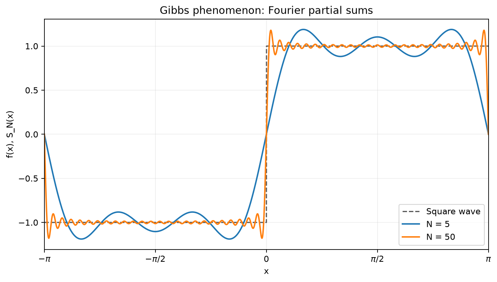
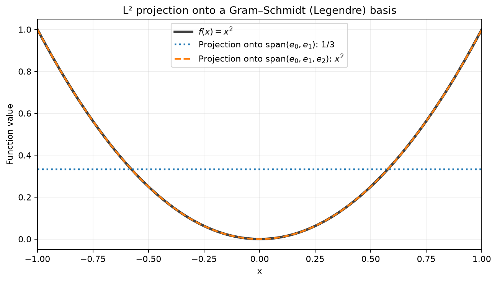
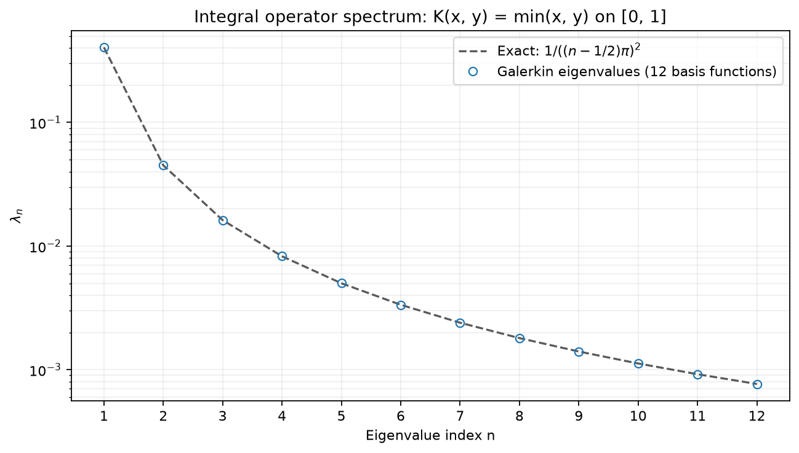

[](https://github.com/ghsihem228-ship-it/mathbridge/actions/workflows/tests.yml)

# mathbridge

A unified layer over NumPy / SciPy / SymPy for the topics that Python leaves scattered:
**functional analysis**, **Fourier series**, **heat and wave PDEs**, and **space curves** (more modules planned).
Every function returns a `Result` carrying the answer, the solution steps, and a plot.

```python
import numpy as np
from mathbridge import functional, fourier

# Functional analysis in L^2([-1, 1])
r = functional.norm(lambda x: x, (-1, 1), explain=True)
basis = functional.gram_schmidt([lambda x: 1, lambda x: x, lambda x: x**2], (-1, 1)).value

# Fourier series of a square wave
sq = lambda x: 1.0 if x > 0 else -1.0
fourier.partial_sum(sq, np.pi, n_terms=15, plot=True)
fourier.gibbs_overshoot(sq, np.pi, n_terms=50, explain=True)
```

## Modules

| Module | Functions |
|---|---|
| `mathbridge.functional` | `inner_product`, `norm`, `distance`, `gram_schmidt`, `project`, `galerkin_matrix`, `integral_operator`, `spectrum`, `operator_norm`, `convergence_report` |
| `mathbridge.fourier` | `coefficients`, `partial_sum`, `parseval`, `gibbs_overshoot` |
| `mathbridge.pde` | `heat_separation`, `heat_fd`, `wave_separation`, `wave_fd` |
| `mathbridge.geometry` | `curvature`, `torsion`, `frenet_frame` |

## Convergence reports

Pass a factory `fn_seq(n)` returning the function f_n, the proposed limit, the
interval, and increasing integer indices:

```python
report = functional.convergence_report(
    lambda n: lambda x: x**n, lambda x: 0.0, (0, 1),
    [1, 2, 4, 8, 16, 32, 64], explain=True, plot=True,
)
print(report.value["l2"])
```

The result contains three lists, ordered by n: `pointwise` holds five absolute
errors per n at evenly spaced points including the endpoints; `sup` holds the
maximum error on a 2001-point grid; `l2` holds the error norm from adaptive
quadrature. The plot shows the maximum sampled pointwise error and the other
two errors on a logarithmic y-axis. Exact zeros are plotted at machine epsilon.

For xⁿ on [0,1], the L² error tends to zero, but the sup error and the pointwise
error at x=1 remain 1. For sin(nx)/n, all three errors tend to zero. The steps
describe apparent convergence from decreasing errors and a negative fitted tail
slope (or errors that are zero throughout). These finite observations do not
prove convergence, and the sup grid can miss narrow peaks.

## Heat and wave equations

The PDE solvers use zero Dirichlet boundary conditions u(0,t)=u(L,t)=0.
Heat solves u_t=α u_xx with initial temperature f; wave solves u_tt=c² u_xx
with initial displacement f and velocity g. Each returns a `Result` whose value
is a callable `u(x, t)`, accepting scalars or broadcastable NumPy arrays.

```python
from mathbridge import pde

f = lambda x: np.sin(np.pi * x)
g = lambda x: 0.0
heat = pde.heat_separation(f, L=1, alpha=0.1, n_terms=10, plot=True)
heat_grid = pde.heat_fd(f, L=1, alpha=0.1, nx=101, dt=0.005, T=1)
wave = pde.wave_separation(f, g, L=1, c=1, n_terms=10, plot=True)
wave_grid = pde.wave_fd(f, g, L=1, c=1, nx=101, dt=0.005, T=1)
print(heat.value(0.5, 0.2), wave_grid.value(0.5, 0.2))
```

Separation uses sine coefficients computed by adaptive quadrature and truncates
to `n_terms` modes. The finite-difference solvers use Crank–Nicolson for heat and
leapfrog for wave, including the initial velocity and acceleration in the first
wave step. `nx` counts spatial points including both endpoints. The effective
time step is `T / ceil(T / dt)` so the final stored time is exactly T. Wave
leapfrog requires `c * effective_dt / dx <= 1`; unstable choices raise `ValueError`.
Crank–Nicolson is unconditionally stable, but accuracy still depends on the grid.

FD solvers store the full space-time grid and interpolate linearly in space and
time for 0≤t≤T; separation solutions allow any t≥0. Spatial queries must lie in
[0,L]. Endpoint values are always zero, including initially. Use initial data
compatible with these boundary conditions. `explain=True` prints method steps;
`plot=True` (or `result.plot()`) shows snapshots at four times.

## Space curves

Curvature, torsion, and Frenet frames accept a callable `r(t)` returning three
real coordinates, or a SymPy matrix/list of three expressions with exactly one
free parameter. Substitute numerical values for any other symbols first. SymPy
curves use exact symbolic derivatives before numerical evaluation; callables use
seven-point centered differences, with an optional step `h` (default ε^(1/7)).
Callable curves must be smooth and defined within 3h of each evaluation point;
numerical third derivatives for torsion are sensitive to the chosen step.

```python
import sympy as sp
from mathbridge import geometry

s = sp.Symbol("s", real=True)
helix = sp.Matrix([2 * sp.cos(s), 2 * sp.sin(s), s])
print(geometry.curvature(helix, [0, 1, 2]).value)  # [0.4, 0.4, 0.4]
print(geometry.torsion(helix, 0).value)           # 0.2
frame = geometry.frenet_frame(helix, 1, explain=True, plot=True)
# Callable alternative:
geometry.curvature(lambda t: [2*np.cos(t), 2*np.sin(t), t], 1)
```

Each `Result.value` is a NumPy array. Curvature and torsion have the shape of
the supplied `t` (a 0-D array for a scalar); Frenet frames have shape
`t.shape + (3,3)`, with rows **T, N, B** and T×N=B. Nonzero speed is required;
torsion and the frame also require nonzero curvature. A circle of radius R has
curvature 1/R and torsion 0. A helix (a cos t, a sin t, b t), a>0, has curvature
a/(a²+b²) and torsion b/(a²+b²).

All three functions support `explain=True` and `plot=True`. Plots draw the curve
and unit T, N, B directions at the first evaluation point; `plot_interval=(a,b)`
sets the displayed parameter interval (default t_first±1). A plot requires a
defined Frenet frame, including when plotting a curvature result.

## Gallery

Square wave Fourier partial sums with N=5 and N=50 show the Gibbs phenomenon.



Projecting x² onto a Legendre-like basis built with `gram_schmidt`: the first two
functions give the constant 1/3, while all three reproduce x² exactly.



Eigenvalues of the integral operator with kernel min(x,y) on [0,1], computed
using `integral_operator`, `galerkin_matrix`, and `spectrum`, compared with the
exact values 1/(((n-1/2)π)²).



Regenerate the PNGs after installing the package:

```bash
python examples/make_figures.py
```

## Roadmap

- Functional: convergence estimates for Galerkin operator approximations
- PDE: Laplace equation and additional boundary conditions
- Differential geometry: geodesics and surfaces
- Numerical methods with the same calling style

## Install and test

```bash
pip install -e ".[dev]"
pytest
```
